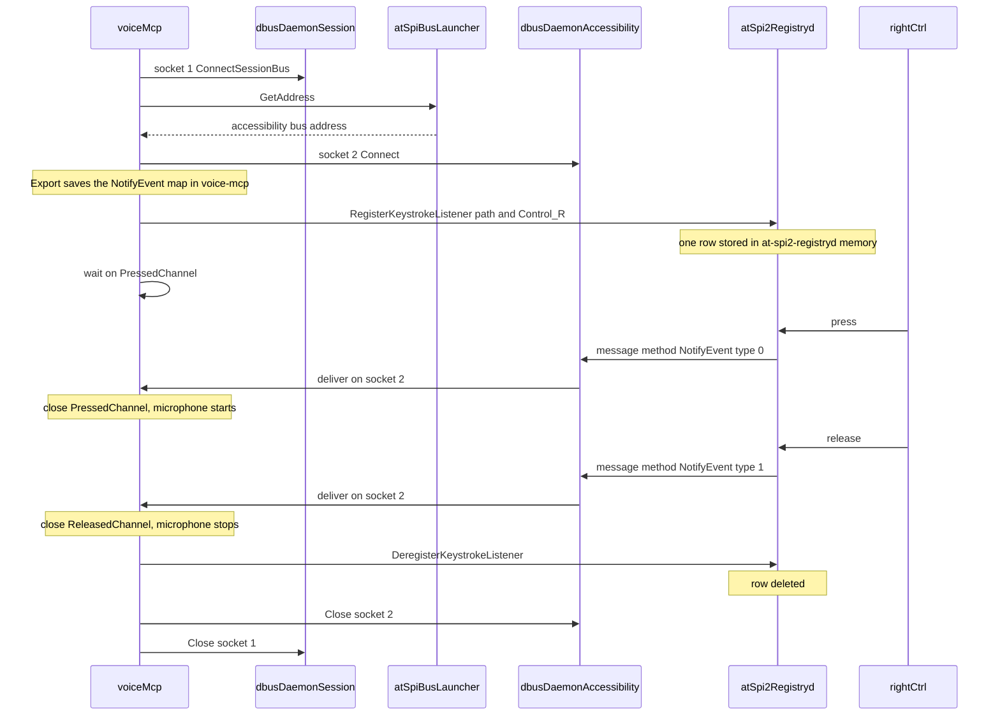

# Hold to talk

This file explains `capture_voice_hold` at intern level. The words in the appendix are the only special words used below.

## What you do

`voice-mcp` is already running because Cursor started it. Pressing Right Ctrl by itself does nothing.

1. A chat calls the tool `capture_voice_hold`.
2. That call waits. The microphone is still off.
3. You hold Right Ctrl and speak.
4. You release Right Ctrl.
5. The tool returns the transcribed text. Both sockets close.

Left Ctrl is ignored. A press while no `capture_voice_hold` call is waiting is ignored, because the registry row exists only during that call.

## Where each thing lives

| Name | What it is |
|---|---|
| `voice-mcp` | Your Go program. The listener, the map, and both channels live here. |
| `dbus-daemon --session` | The session bus. Socket 1 connects to it. |
| `at-spi-bus-launcher` | Answers `GetAddress` on the session bus. |
| `dbus-daemon` at `unix:path=/run/user/1000/at-spi/bus` | The accessibility bus. Socket 2 connects to it. |
| `at-spi2-registryd` | Stores the registry row in its own memory. The row is not a file. |

One `capture_voice_hold` call creates 2 sockets and 2 channels. Both sockets are closed by `cleanup` when the call ends.

## Diagram

## Request flow

- Cursor calls `handleHoldToTalk`. That calls `TranscribeWhileKeyHeld`, which calls `WaitForHold`. None of this runs when the process starts.
- `dbus.ConnectSessionBus()` opens socket 1 from `voice-mcp` to `dbus-daemon --session`.
- `GetAddress` is sent on socket 1 to `at-spi-bus-launcher`. The reply is the accessibility bus address.
- `dbus.Connect(busAddress)` opens socket 2 from `voice-mcp` to the accessibility `dbus-daemon`.
- `Export(listener, "/org/a11y/atspi/listeners/1", "org.a11y.atspi.DeviceEventListener")` runs inside `voice-mcp`. It finds the Go method named `NotifyEvent` and saves a map: the text `"NotifyEvent"` points at that function. The `listener` pointer never leaves `voice-mcp`.
- `RegisterKeystrokeListener` sends a message on socket 2 to `at-spi2-registryd`. The message contains the path `/org/a11y/atspi/listeners/1`, the key name `Control_R`, modifier mask `0`, and event mask `3`. `at-spi2-registryd` appends one row: this socket, this path, this key, press and release.
- `TranscribeWhileKeyHeld` blocks on `hold.PressedChannel`. The microphone is still closed.
- You press Right Ctrl. `at-spi2-registryd` finds the row and sends a message whose method text is `NotifyEvent` and whose `event.Type` is `0`. Socket 2 receives it. The dbus library, inside `voice-mcp`, looks up `"NotifyEvent"` in the map and runs your function.
- That function closes `hold.PressedChannel` once. The wait ends. `CaptureUntil` receives `hold.ReleasedChannel` as `stopChannel` and opens the microphone: 1 channel, 16000 samples per second, 4000 samples per read.
- You speak. Each `stream.Read` appends one buffer. `NotifyEvent` is not involved in the audio.
- You release Right Ctrl. `at-spi2-registryd` sends `NotifyEvent` again with `event.Type` `1`. Your function closes `hold.ReleasedChannel`. The next lap of the microphone loop sees `stopChannel` closed and returns the samples. Up to one extra 0.25 second buffer can be included, because a `Read` already in progress is allowed to finish.
- `textFromSamples` runs Whisper on those samples and returns one string.
- `cleanup` calls `DeregisterKeystrokeListener`, which deletes the row in `at-spi2-registryd`, then closes socket 2 and socket 1.

## Channels in this code

These are the only channels this call creates:

- `hold.PressedChannel` is created in `WaitForHold`. `NotifyEvent` closes it on key down. `TranscribeWhileKeyHeld` waits on it before the microphone opens.
- `hold.ReleasedChannel` is created in `WaitForHold`. `NotifyEvent` closes it on key up. It is passed into `CaptureUntil`.
- `stopChannel` is that same release channel inside `CaptureUntil`. The loop returns the samples when `stopChannel` is closed.

Closing a channel is the signal. The channel carries no audio and no key data. `pressOnce` and `releaseOnce` close each channel only once, because a second close would crash the process.

## The one `go` line we wrote

The only `go` keyword in the voice code is in `WaitForHold`. It starts `voice.WaitForHold.func1`. That goroutine waits until the tool call is cancelled, then runs `cleanup`.

`NotifyEvent` itself runs on `github.com/godbus/dbus/v5.(*Conn).handleCall`, which the dbus library starts inside `voice-mcp` when a message arrives on socket 2. `TranscribeWhileKeyHeld` and `CaptureUntil` run on the goroutine that is already handling the tool call. Those two sides cannot use a normal return value, so they use the two channels.

## Event mask

The number `3` in `RegisterKeystrokeListener` is the event mask. It chooses which actions `at-spi2-registryd` will send.

- `1` means press only.
- `2` means release only.
- `3` means both, because `1 + 2 = 3`.

The number beside it, `0`, is the modifier mask. `0` means no extra key such as Shift has to be held.

After a message arrives, `event.Type` uses a different numbering. `0` means this message is the press. `1` means this message is the release. Event mask `1` and `event.Type` `1` are not the same thing.

`NotifyEvent` returns `false`. That tells `at-spi2-registryd` to also deliver Right Ctrl to the focused window.

## Appendix: keywords

- **Process:** one running program, with its own memory. Two programs cannot see each other's variables.
- **voice-mcp:** the program Cursor starts from `mcp-servers/bin/voice-mcp`.
- **AT-SPI:** GNOME's accessibility program. It already receives key presses when accessibility is on. It does not read your Go files.
- **at-spi-bus-launcher:** the program that owns `org.a11y.Bus` on the session bus and returns the accessibility bus address.
- **at-spi2-registryd:** the program that owns `org.a11y.atspi.Registry` and keeps the registry list in memory.
- **Registry:** that list. One subscription is one row. It is not a file and it is not inside `voice-mcp`.
- **Socket:** an open pipe from a program to a bus. This call opens two.
- **Bus:** a middleman program that carries messages between sockets. The session bus is the first. The accessibility bus is the second.
- **Message:** bytes sent on a bus. A message can carry a path and a method name. It cannot carry a Go object.
- **Path:** the address text `/org/a11y/atspi/listeners/1`.
- **Interface:** the name of a set of methods. `org.a11y.atspi.DeviceEventListener` is the set AT-SPI knows. It contains `NotifyEvent`.
- **Method:** one callable name on an interface. `NotifyEvent` is that name.
- **Export:** the call inside `voice-mcp` that saves the map from the method name to your Go function.
- **Map:** that table. It stays inside `voice-mcp`.
- **RegisterKeystrokeListener:** the message `voice-mcp` sends to `at-spi2-registryd` so it will append one row.
- **DeregisterKeystrokeListener:** the message that deletes that row.
- **NotifyEvent:** your Go function. AT-SPI does not contain it. AT-SPI only sends a message whose method name is the text `NotifyEvent`.
- **deviceEvent:** the packet inside that message. `Type` `0` is press. `Type` `1` is release.
- **Event mask:** the number that selects press, release, or both. `1` is press. `2` is release. `3` is both.
- **Modifier mask:** the number `0` next to the event mask. It means no extra modifier key is required.
- **Control_R:** the key name for Right Ctrl.
- **Goroutine:** another function running at the same time inside `voice-mcp`.
- **Channel:** a signal between two goroutines. `PressedChannel` and `ReleasedChannel` carry no data.
- **Close:** ringing that signal. It can happen once per channel.
- **sync.Once:** runs a function only the first time. Used so a repeated key event does not close a channel twice.
- **select:** waits until one channel is ready.
- **PortAudio:** the microphone library.
- **float32:** one audio sample.
- **Buffer:** one chunk of samples. 4000 samples at 16000 per second is 0.25 seconds.
- **Whisper:** the speech-to-text model. It runs only after the release returns the samples.
